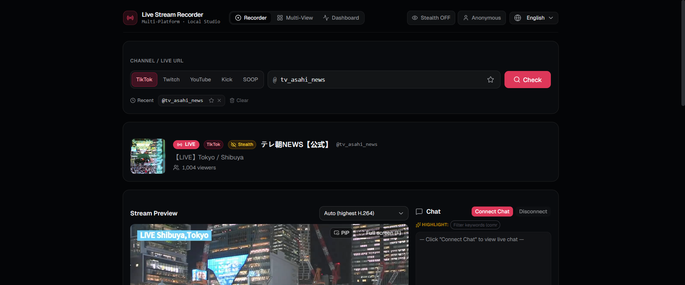

# TikTok LIVE Recorder


A local Node.js and React stack I put together to monitor TikTok LIVE streams, grab chat events, and record broadcasts straight to MP4. It runs locally and is completely unofficial.

Under the hood, it uses the [`tiktok-live-connector`](https://github.com/zerodytrash/TikTok-Live-Connector) library to pull data without needing an API key, and `ffmpeg` to handle the heavy lifting for video.

> [!NOTE]
> **🚀 Version 2.0.0 Coming Soon!**
> - Auto-Merge Split Parts (`_p1`, `_p2`)
> - Live Instant Clipping (clip the last 30/60s while recording)
> - Per-Channel Folder Organization (`@username/`) & Custom Filename Templates
> - Account Cookie Health Check
> - Local SQLite Search Index

---

## Screenshots

### Recorder & Live Preview


### Watchlist, Recordings & Storage Settings


### Multi-View Grid & Operations Dashboard
| Multi-View Grid | Operations Dashboard |
|---|---|
|  |  |

---

## What it does

### The Web UI (`http://localhost:3000`)
- **Watch & Preview:** Look up any user and watch their stream. It supports whatever quality TikTok throws at it (including HEVC/1080p).
- **Chat Capture:** Pulls chat messages, gifts, likes, PK battles, and viewer counts via WebSockets. It auto-reconnects if the connection drops.
- **Recording & Recovery:** Dumps the stream straight to `.mp4` using `ffmpeg` (plus `.events.jsonl` chat logs), with in-band SPS/PPS handling for PK battles, a stalled-stream watchdog, auto-retry, `+faststart` remuxing, Force Audio-Only (`-vn`), configurable audio bitrates, and 720p compression.
- **Watchlist & Alerts:** Add creators you care about with Priority Polling, per-channel schedules, minimum viewer thresholds, per-channel accounts, and Discord / Telegram webhook alerts.
- **Library & Storage:** Pin/protect recordings from auto-cleanup, add custom titles/notes, and configure disk guard, retention limits, or proxy failover lists.
- **Live Grid:** Basically a multi-cam view for watching multiple streams at once.
- **Replay & Clipping:** Synced chat replay with fullscreen chat overlay, mobile-friendly **Background Audio** mode (`MediaSession`), timeline sprite previews, visual In/Out trimmer with live FFmpeg progress, and one-click highlight/PK clips (`9:16` blur, crop, or top/bottom `PK Split`).
- **Multi-Account:** Load multiple session cookies (encrypted at rest) and swap between them in the UI, or toggle "Stealth Mode" to lurk anonymously.
- **Transcoding:** If you're on a browser that hates HEVC (looking at you, Chrome), the backend will auto-detect your GPU (NVENC/QuickSync/AMF) and transcode it to H.264 on the fly.

### CLI Tools
If you don't want to use the UI, you can just run the scripts directly:
- `node check.js <username>` — Returns their current live status.
- `node get-stream.js <username>` — Spits out the raw HLS/FLV urls.
- `node record.js <username>` — Starts recording the stream to disk.

---

## Getting Started

### Prerequisites
- **Node.js** v18+ (I usually run it on 20)
- **ffmpeg / ffprobe** are bundled automatically via `ffmpeg-static` and `ffprobe-static` when you run `npm install`. If you already have `ffmpeg` installed on your system `PATH` (or set `FFMPEG_PATH`), it will be preferred automatically.

### Setup

**Option 1: Using Docker (Recommended)**
If you have Docker installed, you don't even need Node.js or ffmpeg on your host machine.

```bash
docker-compose up -d
```
Then open **`http://localhost:3000`**. The videos will be saved in the `./recordings` folder.

**Option 2: Running locally**
Install the packages for both the backend and frontend. I made a shortcut script for it:

```bash
npm run install:all
```

To run it normally, just build the frontend once and start the Express server:

```bash
npm run build:start
```
Then open **`http://localhost:3000`**.

If you're hacking on the code, you'll probably want hot-reloading. Just run `npm start` in one terminal and `npm run client:dev` in another (or run `.\dev.bat` on Windows).

---

## Config (`.env`)

You honestly don't need to configure anything if you're just watching public game/IRL streams anonymously. 

But if you need to bypass region locks or age restrictions, you'll need to pass your session cookies. Copy `.env.example` to `.env` and fill it out:

```ini
# Find these in your browser devtools (F12) -> Application -> Cookies -> tiktok.com
TIKTOK_SESSIONID=...
TIKTOK_TT_TARGET_IDC=...

# If you're connecting to massive chat rooms, TikTok might rate limit your IP.
# You can bypass this with a free signing key from eulerstream.com
EULER_API_KEY=...
```

> [!IMPORTANT]
# **Don't leak your cookies.**
> The `.gitignore` is already set up to ignore your `.env`, `accounts.json`, `watchlist.json`, and the `recordings/` directory. Keep it that way.

---

## A few tips

- **Stealth Mode:** You can toggle this in the Account Switcher. It strips your session cookies from the requests so you can watch without showing up in the viewer list.
- **Auto-recording:** Just add a user to the Watchlist in the UI and tick the "Auto-record" box. The server will handle the rest in the background.
- **LAN Access:** By default, the server binds to localhost. If you want to watch from your phone on the same Wi-Fi, set `HOST=0.0.0.0` in your `.env`.

---

## License

MIT. 

> [!CAUTION]
> This is just a personal project built for educational purposes. It's not affiliated with TikTok or ByteDance. Please respect their Terms of Service and don't use this to mass-scrape or re-upload people's content without asking them first.
