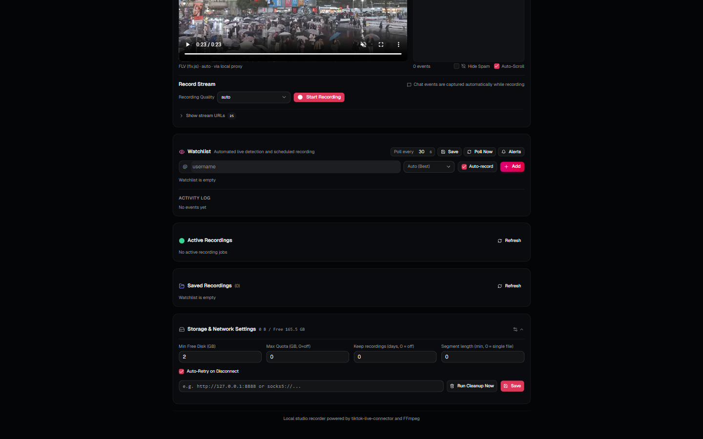
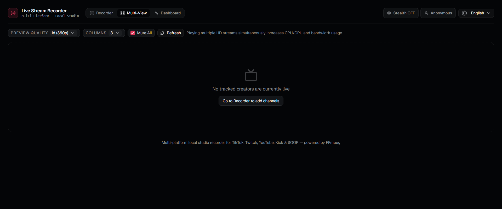
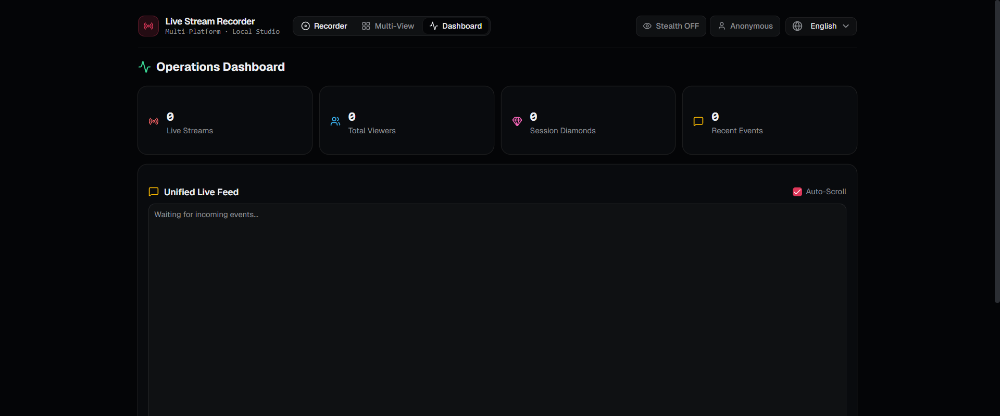

# Live Stream Recorder

[](https://github.com/XploitVoid/tiktok-live-recorder/releases/latest)


A local-first Node.js and React studio *(formerly TikTok LIVE Recorder)* to monitor live channels, archive real-time chat/gift events, detect highlights, and record streams straight to MP4 across **5 platforms**:

| Platform | Stream Capture | Live Chat / Gifts | Stealth / Anonymous |
| :--- | :--- | :--- | :--- |
| **TikTok LIVE** | FLV / HLS (HEVC & H.264) | WebSocket (chat, gifts, likes, PK battles) | Per-platform toggle |
| **Twitch** | HLS (up to Source / 60fps) | IRC / WebSocket | Per-platform toggle |
| **YouTube Live** | HLS + 4K/2K `yt_adaptive` pump | InnerTube Live Chat & Super Chat | Per-platform toggle |
| **Kick** | HLS | Pusher / Centrifugo WebSocket | Per-platform toggle |
| **SOOP (AfreecaTV)** | HLS (Global & Korea) | SOOP Chat WebSocket | Per-platform toggle |

Under the hood, it runs locally with [`ffmpeg`](https://ffmpeg.org/), built-in SQLite FTS5 indexing (`node:sqlite`), and optional `yt-dlp` fallback for resilient multi-platform extraction — no external SaaS or cloud dependencies required.

---

## Screenshots

### Recorder & Live Preview


### Watchlist, Recordings & Storage Settings


### Multi-View Grid & Operations Dashboard
| Multi-View Grid | Operations Dashboard |
|---|---|
|  |  |

---

## What it does

### The Web UI (`http://localhost:3000`)
- **Watch & Preview:** Look up any channel by username or URL (`TikTok`, `Twitch`, `YouTube`, `Kick`, `SOOP`) and preview in native quality (including HEVC/1080p and YouTube 4K/2K).
- **Chat Capture:** Pulls chat messages, gifts/Super Chats, likes, subscriptions, PK battles, and viewer counts in real time with automatic reconnects.
- **Recording & Recovery:** Captures streams to `.mp4` or `.ts` (auto-remuxed with `+faststart`) alongside `.events.jsonl` sidecars, with in-band SPS/PPS handling, stalled-stream watchdog, auto-retry, **Auto-Merge Split Parts**, **Live Instant Clip** (30s/60s while recording), Force Audio-Only (`-vn`), configurable audio bitrates, and 720p compression.
- **Watchlist & Alerts:** Monitor creators across all 5 platforms with Priority Polling, per-channel schedules, minimum viewer thresholds, per-channel account binding, and Discord / Telegram webhook alerts.
- **Library, Storage & SQLite Search:** Organize into creator subfolders (`@username/`) with custom filename templates, pin/protect recordings, add notes/titles, search chat history across recordings via local SQLite FTS5 (`recorder.db`), and enforce disk guard / retention / proxy failover rules.
- **Multi-View Grid & Operations Dashboard:** Watch multiple live streams simultaneously and inspect live activity feeds across platforms.
- **Replay & Smart Highlights v2:** Synced chat replay, fullscreen chat overlay, mobile **Background Audio** (`MediaSession`), timeline sprite previews, visual In/Out trimmer, Smart Highlights v2 (MAD Z-score + Thai/EN hype detection + audio peak fusion), Gift Economy analytics, and `9:16` / `PK Split` clip export.
- **Multi-Account & Unified Stealth Engine:** Store encrypted per-platform credentials at rest (`accounts.json` + `.accounts.key`) with automatic cookie health checks, or toggle global / per-platform **Stealth Mode** to strip identity headers and stay anonymous.
- **Transcoding:** Hardware-accelerated H.264 on-the-fly transcoding (auto-detecting NVENC / QuickSync / AMF) when browsers cannot play HEVC directly.

### CLI Tools
If you don't want to use the UI, you can run the scripts directly (passing a username or full platform URL):
- `node check.js <channel-or-url>` — Returns current live status.
- `node get-stream.js <channel-or-url>` — Prints resolved HLS/FLV stream URLs.
- `node record.js <channel-or-url>` — Starts recording the stream to disk.

---

## Getting Started

### Prerequisites
- **Node.js** v20+ (v22 recommended; standalone releases bundle Node.js automatically)
- **ffmpeg / ffprobe** are bundled via `ffmpeg-static` and `ffprobe-static` when you run `npm install` (or via Docker `apk`). System `ffmpeg` on `PATH` or `FFMPEG_PATH` is preferred when available.
- **yt-dlp** (optional) is used as a fallback extractor on supported platforms if primary extraction fails.

### Setup

**Option 1: Pre-built Releases (Recommended for Desktop — No Node.js or FFmpeg required)**
Download the standalone package for your OS from the [GitHub Releases](https://github.com/XploitVoid/tiktok-live-recorder/releases) page:
- **Windows Installer (`*-windows-x64-setup.exe`)** — Standard installer with Start Menu & optional Desktop shortcut (preserves `recordings/`, `.env`, accounts, and watchlist across upgrades).
- **Windows Portable (`*-windows-x64-portable.zip`)** — Extract anywhere and double-click `TikTok LIVE Recorder.bat`.
- **Linux / macOS (`*-linux-x64.tar.gz`, `*-macos-arm64.tar.gz`, `*-macos-x64.tar.gz`)** — Extract and run `./start.sh` (or double-click `Start TikTok LIVE Recorder.command` on macOS).
- Every release ships with `SHA256SUMS.txt` and `SOURCE.txt` so you can verify file integrity before running.

**Option 2: Using Docker**
If you have Docker installed, you don't even need Node.js or ffmpeg on your host machine.

```bash
docker-compose up -d
```
Then open **`http://localhost:3000`**. The videos will be saved in the `./recordings` folder.

**Option 3: Running from Source**
Install the packages for both the backend and frontend. I made a shortcut script for it:

```bash
npm run install:all
```

To run it normally, just build the frontend once and start the Express server:

```bash
npm run build:start
```
Then open **`http://localhost:3000`**.

If you're hacking on the code, you'll probably want hot-reloading. Just run `npm start` in one terminal and `npm run client:dev` in another (or run `.\dev.bat` on Windows).

---

## Config (`.env`)

You don't need any config to watch or record public streams anonymously. Copy `.env.example` to `.env` when you want remote auth (`APP_TOKEN`), session cookies, proxy failover, webhooks, or custom storage limits:

```ini
# Remote access auth (send via Web UI login cookie or X-App-Token header)
APP_TOKEN=...
ACCOUNTS_SECRET=...

# Optional TikTok session cookies (or manage multi-platform accounts encrypted in the UI)
TIKTOK_SESSIONID=...
TIKTOK_TT_TARGET_IDC=...
EULER_API_KEY=...

# Optional Stealth Mode (anonymizes all 5 platforms on startup)
STEALTH_MODE=0
```

> [!IMPORTANT]
> **Don't leak your secrets.**
> `.gitignore` and `.dockerignore` exclude `.env`, `accounts.json`, `.accounts.key`, `watchlist.json`, `settings.json`, `recorder.db*`, `*.key`, `*.pem`, and `recordings/`.

---

## A few tips

- **Stealth Mode:** Toggle globally or per-platform in the Account Switcher or Settings to strip cookies/identity headers and lurk anonymously.
- **Auto-recording:** Add any channel URL or username to the Watchlist in the UI and enable Auto-Record.
- **LAN Access:** By default, the server binds to `127.0.0.1`. Set `HOST=0.0.0.0` alongside a strong `APP_TOKEN` and `ALLOWED_HOSTS` in `.env` when exposing on a LAN.

---

## License

MIT.

> [!CAUTION]
> Personal educational project with no affiliation to TikTok/ByteDance, Twitch/Amazon, YouTube/Google, Kick, or SOOP. Please respect each platform's Terms of Service and creators' rights before recording or redistributing any content.
